<p align="center">
  <a href="https://ivlis-studio.github.io/nearclip/?lang=ko">
    <picture>
      <source media="(prefers-color-scheme: dark)" srcset="docs/readme/banner-ko-dark.png">
      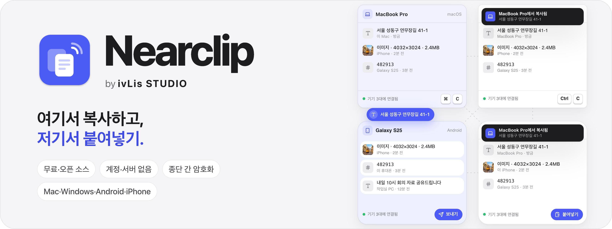
    </picture>
  </a>
</p>

<p align="center">
  <a href="https://github.com/ivLis-Studio/nearclip/releases/latest"></a>
  <a href="https://github.com/ivLis-Studio/nearclip/releases"></a>
  
  
  
  
  <a href="LICENSE"></a>
</p>

<p align="center"><b>Mac·Windows·Android·iPhone 모두 무료</b> — 계정도, 서버도 없이 종단 간 암호화.</p>

<p align="center">
  <a href="https://github.com/ivLis-Studio/nearclip/releases/latest"><b>다운로드</b></a> ·
  <a href="https://ivlis-studio.github.io/nearclip/?lang=ko"><b>웹사이트</b></a> ·
  <a href="#설치">설치</a> ·
  <a href="#동작-방식">동작 방식</a> ·
  <a href="docs/PROTOCOL.md">프로토콜</a> ·
  <a href="README.md">English</a>
</p>

<!-- FILM -->
<p align="center">
  <a href="https://ivlis-studio.github.io/nearclip/?lang=ko#film">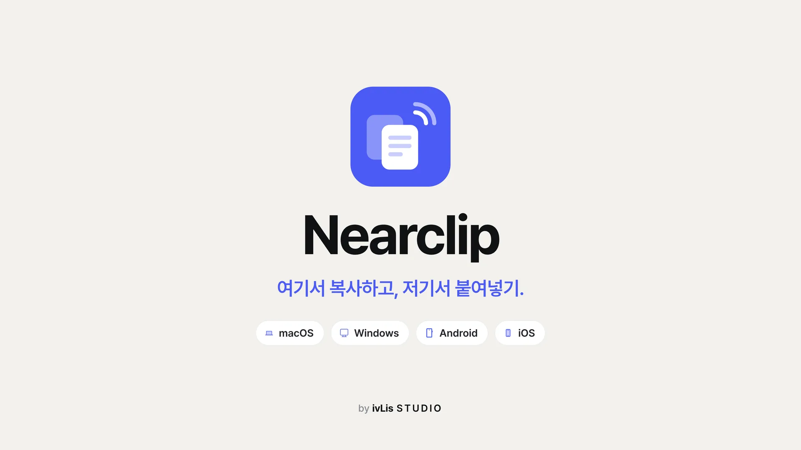</a>
</p>

<p align="center"><sub>39초 · 소리를 켜고 보세요 · <a href="https://ivlis-studio.github.io/nearclip/?lang=ko#film">웹사이트에서 보기</a></sub></p>

## 한 기기에서 복사하고, 다른 기기에서 붙여넣기

Nearclip은 Mac, Windows PC, Android 폰, iPhone과 iPad의 클립보드와 검색 가능한 기록을 하나로 묶어 줍니다.
Mac과 iPhone, 일부 Windows PC와 Android 폰끼리는 이미 클립보드를 나눠 쓰지만, Nearclip은 제조사와 상관없이
**모든 기기를 모든 기기와** 잇습니다.

같은 Wi‑Fi에서는 기기끼리 서로를 찾아 바로 통신합니다. **원격 연결**을 켜면 앱마다 내장된 Tailscale 노드를 통해
네트워크가 달라도 서로 닿습니다. **Nearclip 서버도, 계정도 없고**, 모든 내용은 내 기기만 가진 키로 **종단 간 암호화**됩니다.

<table>
  <tr>
    <td width="33%" valign="top">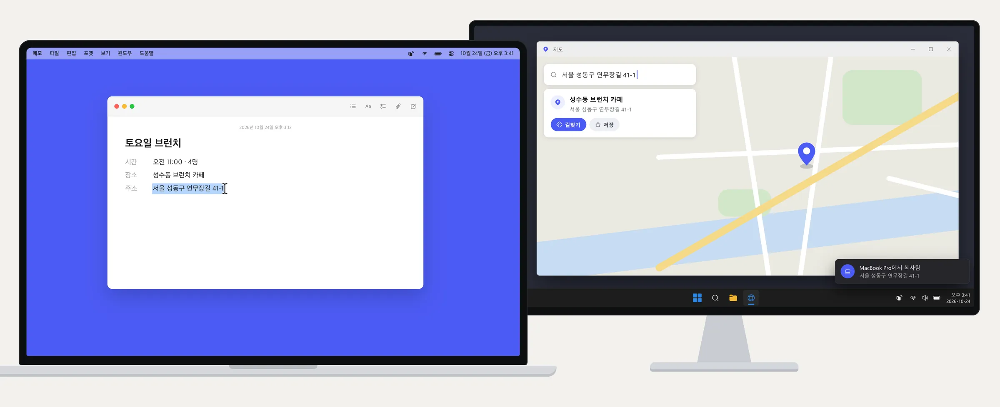<br><b>Mac → Windows PC</b><br><sub>메모에 적어 둔 주소를 PC 지도 검색창에 그대로.</sub></td>
    <td width="33%" valign="top">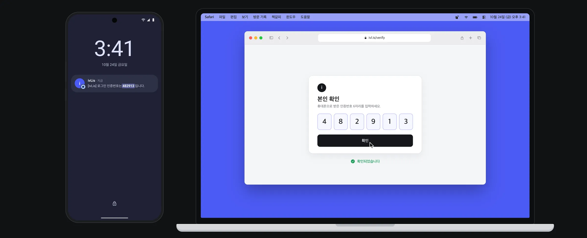<br><b>Android → Mac</b><br><sub>갤럭시로 온 인증번호, Mac에서 ⌘V 한 번이면 끝.</sub></td>
    <td width="33%" valign="top">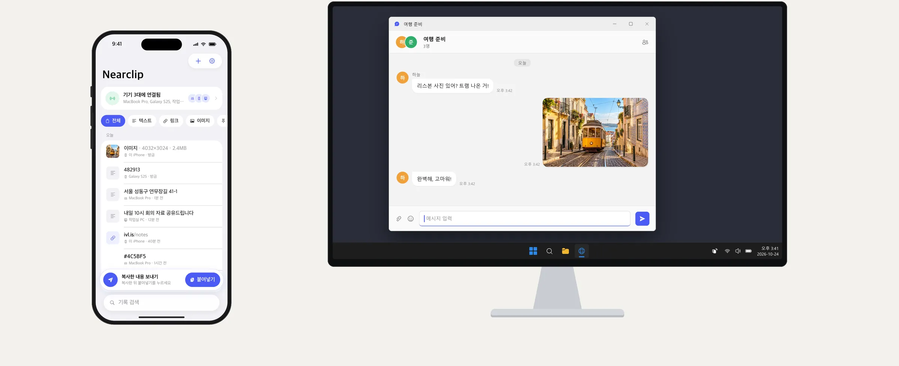<br><b>iPhone → Windows PC</b><br><sub>방금 찍은 사진을 PC 채팅창에 Ctrl+V로.</sub></td>
  </tr>
</table>

## 네이티브 앱 네 개

<table>
  <tr>
    <td align="center" valign="top" width="25%">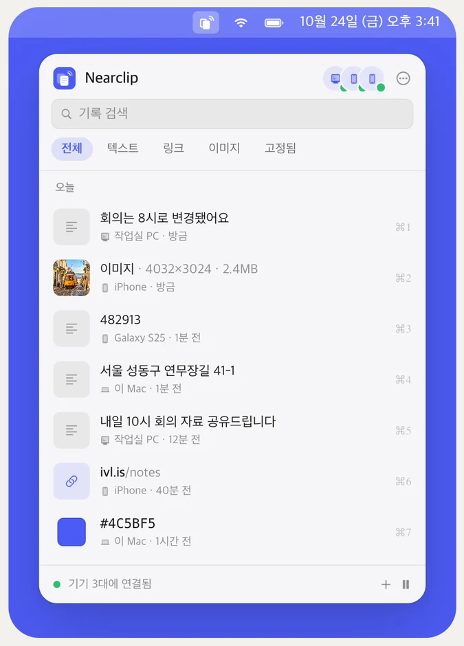<br><b>macOS</b><br><sub>메뉴 막대 앱 · <kbd>⌃⌘V</kbd>로 기록 패널 열기</sub></td>
    <td align="center" valign="top" width="25%">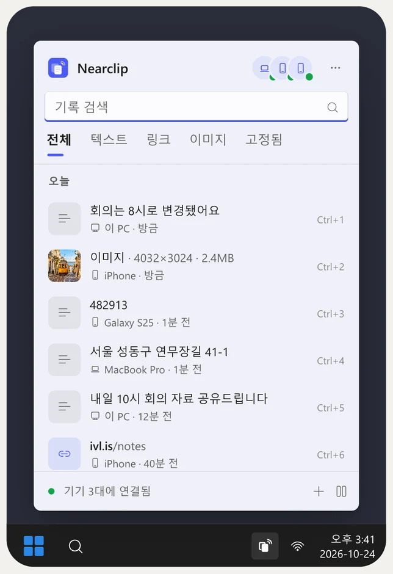<br><b>Windows</b><br><sub>알림 영역 앱 · <kbd>Win</kbd> <kbd>Alt</kbd> <kbd>V</kbd>로 플라이아웃 열기</sub></td>
    <td align="center" valign="top" width="25%">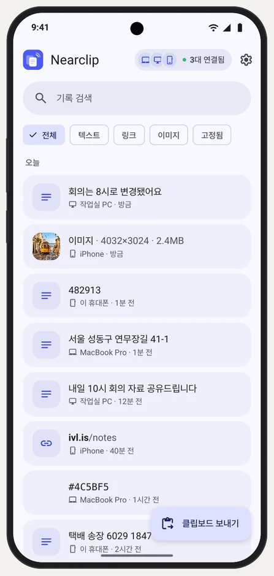<br><b>Android</b><br><sub>백그라운드에서 받기 · 타일, 공유, 텍스트 메뉴로 보내기</sub></td>
    <td align="center" valign="top" width="25%">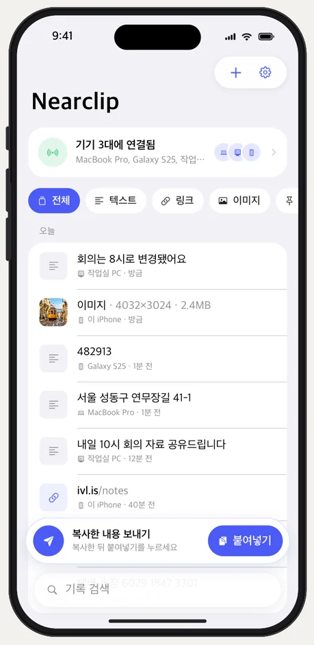<br><b>iPhone &amp; iPad</b><br><sub>붙여넣기를 탭해 보내기 · 열자마자 밀린 내용 받기</sub></td>
  </tr>
</table>
<p align="center"><sub>소개 영상에 그린, 네 앱의 같은 기록. 실제 앱 화면은 <a href="#스크린샷">아래</a>와 <a href="docs/screenshots">docs/screenshots</a>에 있습니다.</sub></p>

| | macOS | Windows | Android | iOS / iPadOS |
|---|---|---|---|---|
| 만든 기술 | Swift · SwiftUI + AppKit | C# · WinUI 3 (Windows App SDK) | Kotlin · Jetpack Compose | Swift · SwiftUI |
| 보내기 | 복사하면 자동 | 복사하면 자동 | 앱, 빠른 설정 타일, 알림, 공유, 텍스트 선택 — 또는 Shizuku로 즉시 | 붙여넣기 버튼, 또는 앱을 열 때 자동 |
| 받기 | 자동 (+알림) | 자동 (+알림) | 백그라운드에서 자동 | 앱이 열려 있을 때 (+열면 밀린 내용) |
| 요구 사항 | macOS 14 | Windows 10 1809 | Android 8 | iOS 17 |
| 소스 | [apple/macOS](apple/macOS) | [windows/](windows) | [android/](android) | [apple/iOS](apple/iOS) |

Electron도, 웹뷰도 없습니다. 앱마다 그 플랫폼의 컨트롤, 글꼴, 아이콘을 씁니다.

## 기능

- 텍스트(최대 4MB), 링크, 색상, 이미지(최대 32MB, PNG 또는 JPEG) **실시간 동기화**
- **큰 이미지도 바로 보입니다.** 이미지를 복사한 기기가 인코딩하기 전에 먼저 알려서, 다른 기기에 곧바로
  *iPhone에서 이미지 받는 중…*과 용량, 진행률 바가 뜹니다(컴퓨터는 알림, 휴대폰 앱은 카드, Android 백그라운드는 조용한
  배너). 다 받으면 같은 자리가 *iPhone에서 복사됨*으로 바뀝니다.
- 모든 기기에 **같은 기록**: 검색, 필터(텍스트·링크·이미지·고정됨), 고정, 모든 기기에서 삭제
- **계정 없는 연결**: 휴대폰으로 QR 코드를 스캔하거나, 주변 컴퓨터를 골라 두 화면의 6자리 코드를 비교합니다. 연결된 기기라면
  어느 기기에서든 새 기기를 추가할 수 있습니다.
- **메시 동기화**: 닿는 모든 기기끼리 연결하고 받은 클립을 전달하므로, 일부만 연결돼도 결국 모두 같아집니다. 잠시 떨어져
  있던 기기는 돌아오면 최근 7일 치를 받습니다.
- **원격 연결**(선택): *다른 네트워크에서도 동기화*를 켜고 기기마다 같은 무료 Tailscale 계정으로 로그인하세요. 앱마다
  Tailscale 노드가 내장되어 있어 따로 설치할 것도, VPN 프로필도 없습니다. Wi‑Fi가 항상 우선이고, 기기마다 연결 방식
  (*연결됨 · 같은 네트워크* 또는 *연결됨 · 원격*)을 보여 줍니다.
- **개인정보 보호**: 비밀번호 관리자가 비공개로 표시한 항목은 동기화하지 않습니다(macOS `org.nspasteboard.ConcealedType`,
  Windows `ExcludeClipboardContentFromMonitorProcessing`, Android `EXTRA_IS_SENSITIVE`). 컴퓨터에선 앱을 제외할 수 있고,
  모든 기기에서 일시정지할 수 있습니다.
- **플랫폼다운 완성도**: macOS 26 Liquid Glass, Windows 11 Mica, Android Material You · 라이트/다크 · 한국어/영어 ·
  키보드 중심 데스크톱 패널

## 설치

### Mac

1. [릴리스](https://github.com/ivLis-Studio/nearclip/releases/latest)에서 **Nearclip-macOS.zip**을 내려받아 압축을 풀고,
   Nearclip을 응용 프로그램 폴더로 옮기세요.
2. 여세요. Apple의 서명과 공증을 받은 앱이라 다른 앱처럼 바로 열립니다. 메뉴 막대에서 지내며, <kbd>⌃⌘V</kbd>로 기록을 엽니다.
3. Nearclip이 처음 클립보드를 읽을 때 macOS가 묻습니다. **항상 허용**을 고르세요(시스템 설정 › 개인정보 보호 및 보안 ›
   다른 앱에서 붙여넣기). **로컬 네트워크** 접근도 허용하세요.

macOS 14 이상, Apple 실리콘과 Intel 모두 지원합니다.

### Windows

1. [릴리스](https://github.com/ivLis-Studio/nearclip/releases/latest)에서 **Nearclip-Windows-x64.zip**(스냅드래곤 PC는
   **Nearclip-Windows-arm64.zip**)을 내려받아 아무 곳에나 압축을 풀고 `Nearclip\Nearclip.exe`를 실행하세요.
2. 아직 코드 서명 전이라 SmartScreen이 **"Windows의 PC 보호"**를 띄우면 **추가 정보 › 실행**을 누르세요.
3. 방화벽이 물어보면 **개인 네트워크**에서 허용하세요. 시작 화면과 설정에서 방화벽 상태와 *허용…* 버튼을 볼 수 있습니다.

Windows 10 1809 이상 또는 Windows 11(x64, Arm64)에서 동작합니다. 폴더 하나로 완결되어 설치 프로그램도, .NET 설치도
필요 없습니다. 알림 영역에서 지내며, <kbd>Win</kbd> <kbd>Alt</kbd> <kbd>V</kbd>로 기록을 엽니다.

### Android

1. 휴대폰에서 [릴리스](https://github.com/ivLis-Studio/nearclip/releases/latest)의 **Nearclip-Android.apk**를 내려받아
   여세요. 물어보면 브라우저의 알 수 없는 앱 설치를 허용하세요.
2. 알림을 허용하세요. 백그라운드 연결을 유지하고 도착한 내용을 보여 줍니다.
3. 선택: 설정 › **복사한 항목 바로 Nearclip에 불러오기**를 켜면 [Shizuku](https://shizuku.rikka.app)로 텍스트와 링크를
   복사하자마자 보냅니다. 설정 화면이 과정을 안내하며, 켜기 전에는 아무것도 바뀌지 않습니다.

Android 8 이상에서 동작합니다.

### iPhone과 iPad

아직 App Store에는 없습니다. 직접 빌드하는 데 몇 분이면 됩니다.

1. Xcode와 [XcodeGen](https://github.com/yonaskolb/XcodeGen)(`brew install xcodegen`)을 설치하고, 내장 Tailscale
   라이브러리를 빌드하세요: `tailnet/build.sh apple`(Go 필요, [tailnet/README.md](tailnet/README.md) 참고).
2. `cd apple && xcodegen generate && open Nearclip.xcodeproj`
3. **NearclipiOS** 스킴을 고르고 *Signing & Capabilities*에서 내 Apple ID를 팀으로 선택한 뒤 iPhone이나 iPad에서
   실행하세요. 무료 Apple ID로 설치한 앱은 7일마다 다시 설치해야 합니다.

iOS 17 이상에서 동작합니다.

### 기기 추가

이미 설정한 기기에서 **기기 추가**를 여세요.

- **휴대폰**: Nearclip 앱으로 QR 코드를 스캔하세요(카메라 앱도 됩니다).
- **컴퓨터**: *주변 기기*에서 고르고 두 화면에 같은 6자리 코드가 떴는지 확인하세요.
- 기기 간 검색을 막는 **게스트·회사 Wi‑Fi**: *주소로 연결*을 쓰세요.
- **서로 다른 네트워크**: 기기마다 **원격 연결**을 켜고 같은 무료 Tailscale 계정으로 로그인하세요.

## 동작 방식

```
 Mac ──────────── Windows PC         • 기기 찾기: DNS-SD 서비스 _nearclip._tcp (Bonjour / mDNS)
  │  ╲          ╱    │               • 전송: 기기 쌍마다 TCP 연결 하나, 길이 접두 프레임
  │    ╲      ╱      │               • 암호화: P-256 ECDH(일회용 키) + HKDF-SHA256 + AES-256-GCM
 iPhone ──── Android                  • 한 기기에서 받은 클립은 다른 기기로 전달(ID로 중복 제거)
```

- 설치할 때마다 무작위 256비트 키를 가진 **그룹**이 만들어지고, 연결(페어링)은 QR 비밀값이나 6자리 숫자 비교(커밋먼트
  포함 — 중간자가 숫자를 맞출 수 없음)로 인증된 채널을 통해 새 기기에 그 키를 전달합니다.
- 연결마다 그룹 키에 묶인 일회용 ECDH 핸드셰이크로 전방 보안을 제공하며, 클립·기기 목록·연결 결과는 모두 암호화됩니다.
  통신 규격은 [docs/PROTOCOL.md](docs/PROTOCOL.md)에, 검증 데이터는 [spec/test-vectors.json](spec/test-vectors.json)에
  있으며 Swift·Kotlin·C# 엔진이 모두 통과합니다.
- **원격 연결**([PROTOCOL.md §10](docs/PROTOCOL.md), [tailnet/](tailnet/README.md)): 앱마다 [tsnet](https://tailscale.com/kb/1244/tsnet)
  노드를 사용자 공간에서 실행합니다(WireGuard와 gVisor 네트워크 스택, 시스템 VPN 아님). 노드 이름은 `nearclip-<기기>-<id>`이고,
  같은 그룹의 기기들은 테일넷 기기 목록에서 이 이름으로 서로를 찾아 노드를 통해 연결합니다. NAT 통과가 되면 직접, 안 되면
  Tailscale 중계(DERP)를 거칩니다. Nearclip 세션과 암호화는 WireGuard 안에서 그대로 돌기 때문에, Tailscale 조정 서버는 기기
  이름과 주소만 볼 뿐 클립은 볼 수 없습니다.
- 제품·UX 결정(용어, 흐름, 플랫폼별 화면)은 [docs/DESIGN.md](docs/DESIGN.md)에 있습니다.

## 개인정보

Nearclip에는 서버도, 계정도, 분석이나 원격 측정도 없습니다. 기록은 내가 정한 기간(기본 30일) 동안 내 기기에만 남고,
클립을 지우면 모든 기기에서 지워집니다. 전체 방침은 [웹사이트](https://ivlis-studio.github.io/nearclip/privacy.html#ko)에
한국어와 영어로 있습니다.

## 소스에서 빌드

| 폴더 | 내용 |
|---|---|
| [apple/](apple) | macOS·iOS 앱(XcodeGen 프로젝트)과 Swift 엔진 **NearclipKit**, CLI |
| [windows/](windows/README.md) | WinUI 3 앱과 C# 엔진 |
| [android/](android/README.md) | Android 앱, Kotlin 엔진(`:core`), 상호 운용 CLI |
| [tailnet/](tailnet/README.md) | 네 앱이 함께 쓰는 내장 Tailscale 라이브러리(Go) |
| [docs/](docs), [spec/](spec) | 프로토콜, 디자인 문서, 플랫폼 공통 테스트 벡터 |
| [tools/](tools) | 상호 운용 러너와 인수 테스트 스크립트 |
| [design/](design) | 플랫폼별 앱 아이콘 |
| [promo/](promo/README.md) | 코드로 렌더링한 소개 영상 |
| [website/](website/README.md) | [ivlis-studio.github.io/nearclip](https://ivlis-studio.github.io/nearclip/) |

**먼저 내장 Tailscale 라이브러리.** 원격 연결에는 플랫폼마다 작은 Go 라이브러리가 필요하며, Xcode·Gradle·.NET 밖에서
빌드합니다(없으면 앱 빌드가 친절한 메시지와 함께 멈춥니다).

```sh
tailnet/build.sh all              # Go(tailnet/go.mod), Xcode, Android NDK, llvm-mingw — tailnet/README.md 참고
```

`apple/NearclipKit/Binaries/NCTailnet.xcframework`, `android/app/src/main/jniLibs/*/libnctailnet.so`,
`windows/native/win-*/nctailnet.dll`(모두 gitignore 대상)을 만들고 `tailnet/notices/THIRD_PARTY_NOTICES.txt`를 갱신합니다.

**macOS·iOS** — Xcode 16 이상(Xcode 27로 빌드·테스트), XcodeGen:

```sh
cd apple
xcodegen generate                 # Nearclip.xcodeproj(커밋되어 있음), 스킴 Nearclip(macOS)·NearclipiOS
scripts/build-release.sh          # 유니버설 dist/Nearclip-macOS.zip, ad-hoc 서명
SIGN_IDENTITY="Developer ID Application: …" NOTARY_PROFILE=<notarytool 프로필> scripts/build-release.sh   # 공증까지
```

**Android** — [android/README.md](android/README.md) 참고. `android/scripts/build-release.sh`가 R8 릴리스를 빌드하고 릴리스
키로 서명합니다. **Windows** — [windows/README.md](windows/README.md) 참고(`dotnet publish`, .NET 10 SDK만 있으면 되고
Visual Studio는 필요 없습니다).

## 테스트

| 테스트 | 명령 |
|---|---|
| Swift 엔진(벡터 + localhost 연결·동기화 시나리오) | `cd apple/NearclipKit && swift test` |
| Kotlin 엔진 | `cd android && ./gradlew :core:test` |
| C# 엔진 | `cd windows && dotnet test --project tests/Nearclip.Core.Tests/Nearclip.Core.Tests.csproj` |
| Tailnet 브리지(Go, 프로세스 내 조정 서버 대상) | `cd tailnet && go test ./...` |
| **구현 간 상호 운용**(Swift × Kotlin × C#, 원격·이미지 진행률 포함 48개 시나리오) | `python3 tools/interop/run.py` |
| iOS UI 흐름(시작 → 연결 → 밀린 내용 → 보내기, 원격, 라이선스) | `xcodebuild test -scheme NearclipiOS …` (`apple/iOSUITests` 참고) |
| macOS 인수 데모(실제 앱 + 가상 기기) | `python3 apple/tools/demo.py` |
| 실제 앱의 큰 이미지 진행률(천천히 보내는 기기, 스크린샷) | `tools/acceptance/mac_transfer.py`, `windows_transfer.py`, `android_transfer.py`, `apple/tools/ios_transfer.py` |
| 실제 앱의 원격 연결(일회용 Tailscale 조정 서버) | `apple/tools/remote_demo.py`, `apple/tools/ios_remote.py`, `tools/acceptance/android_remote.py`, `windows_remote.py` |
| 실제 Tailscale 서비스 대상 원격 연결(사람이 로그인) | `python3 tools/acceptance/real_remote.py` |
| 웹사이트(두 언어, 실시간 데모, 영상, 휴대폰 레이아웃) | `cd website && npm install && npm test` |

<details>
<summary><b>지금까지 검증한 것</b></summary>

- **엔진**: Swift 12개, Kotlin 24개, C# 33개 테스트와 Go 브리지 테스트 — `spec/test-vectors.json`의 모든 값, 실제
  localhost 연결·동기화 시나리오, 테일넷 연결·검색 로직.
- **상호 운용**: `tools/interop/run.py`가 Swift × Kotlin × C# **48/48** 시나리오 통과(모든 방향의 QR·코드 연결, 한국어+이모지
  실시간 텍스트, 여러 조각 이미지, 모든 기기에서 삭제, 재시작 후 밀린 내용, 제거, 제거한 기기 다시 추가, 모든 순열의 3단계
  메시 전달, 모든 쌍의 이미지 진행률, 원격: 모든 쌍이 LAN에서 연결한 뒤 원격 연결로 다시 만나 테일넷으로 서로를 찾고 양방향 동기화).
- **실제 앱의 큰 이미지 진행률**(10.6MB 사진을 0.9MB/s로 보내는 기기): macOS 앱, Windows 11 ARM64 VM, Android 16 에뮬레이터,
  iPhone 시뮬레이터가 *…에서 이미지 받는 중*과 *준비 중…*, 늘어나는 용량을 보여 준 뒤 같은 자리에서 *…에서 복사됨*으로 바뀌고
  클립보드에 이미지가 들어갔습니다. 알림 취소, 전송 중 끊김, 자동 복사 끔도 설계대로 동작했습니다.
- **배포 빌드 자체**: macOS zip을 격리된 인스턴스로 실행(Developer ID 서명, 공증 티켓, 유니버설 바이너리, 연결, 양방향 텍스트),
  Android 릴리스 APK, Windows arm64·x64 빌드(링크로 연결, Windows 클립보드로 양방향 텍스트). 이어서 네 앱을 한 그룹으로
  (macOS 빌드, Windows VM, Android 에뮬레이터, iPhone 시뮬레이터): 각 기기가 보낸 텍스트를 나머지 세 기기가 받았고,
  출처도 정확했습니다.
- **실제 앱, 한 그룹**(macOS 앱, iPhone·iPad 시뮬레이터, Android 16 에뮬레이터, Windows 11 ARM64 VM): 플랫폼마다 복사한
  클립이 나머지 모든 기기에 도착. Mac끼리, Mac ↔ iOS, Mac ↔ Windows, Android → Mac의 Bonjour/mDNS 검색, 6자리 코드가
  일치하는 코드 연결, 비밀번호 관리자 항목 건너뛰기.
- **원격 연결**(일회용 Tailscale 조정 서버, 실제 tsnet·WireGuard·DERP 코드): 네 앱 모두 LAN으로 닿지 않는 기기를
  *연결됨 · 원격*으로 표시하고 클립을 받았습니다. **실제 Tailscale 서비스**: macOS 앱과 Android 앱이 로그인한 뒤, LAN
  경로를 끊자 서로를 *연결됨 · 원격*으로 표시하고 직접 WireGuard 경로로 양방향 동기화했습니다.
- **아직 검증하지 못한 것**: 이번 확인에서의 실제 휴대폰과 실제 Windows PC, 서로 다른 실제 네트워크(인터넷을 건너는 NAT 통과와
  DERP 중계), 실제 Tailscale 서비스에서의 iPhone·Windows, 배터리 사용량.

</details>

## 제한 사항

- 원격 연결 없이는 기기들이 **같은 로컬 네트워크**에 있어야 합니다. 기기 간 통신이나 mDNS를 막는 게스트·회사 Wi‑Fi에서는
  *주소로 연결*을 쓰세요. 원격 연결은 기기마다 무료 Tailscale 계정 로그인이 필요하며, 직접 경로가 없으면 Tailscale 중계를
  거칩니다(여전히 종단 간 암호화, 대신 느림). 접근 규칙을 바꾼 테일넷은 기기 사이 TCP 45821을 허용해야 합니다.
- iOS는 Nearclip이 열려 있는 동안만 동기화합니다(iOS가 백그라운드 클립보드 접근을 허용하지 않음). 열자마자 밀린 내용을
  받고, 가장 최근 클립을 자동으로 복사할 수 있습니다. 원격 연결도 마찬가지입니다.
- Android 10 이상은 앞에 떠 있는 앱만 클립보드를 읽을 수 있어서, Shizuku로 즉시 불러오기를 켜지 않으면 앱·타일·알림·공유·
  텍스트 선택 메뉴로 보냅니다(루팅하지 않은 폰은 재부팅 후 Shizuku를 다시 시작해야 하고, Android 12 이상은 복사할 때마다
  클립보드 접근 알림이 뜰 수 있습니다). 받기는 백그라운드에서 됩니다.
- 기기 제거는 협조 방식입니다. 키를 완전히 바꾸려면 그룹에서 나간 뒤 남은 기기들을 다시 연결하세요.
- Windows 빌드는 아직 코드 서명 전이라 내려받은 파일에 SmartScreen 경고가 뜨고, 설치 프로그램 대신 폴더 하나로 배포됩니다.
  Android APK는 Nearclip 릴리스 키로 서명되어 있어, 예전 테스트 빌드를 설치했다면 먼저 삭제해야 합니다.

## 스크린샷

<table>
<tr>
<td align="center">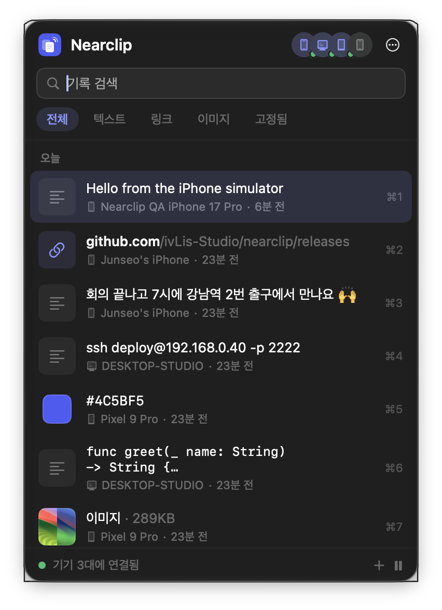<br><sub>macOS · 메뉴 막대 패널 (⌃⌘V)</sub></td>
<td align="center">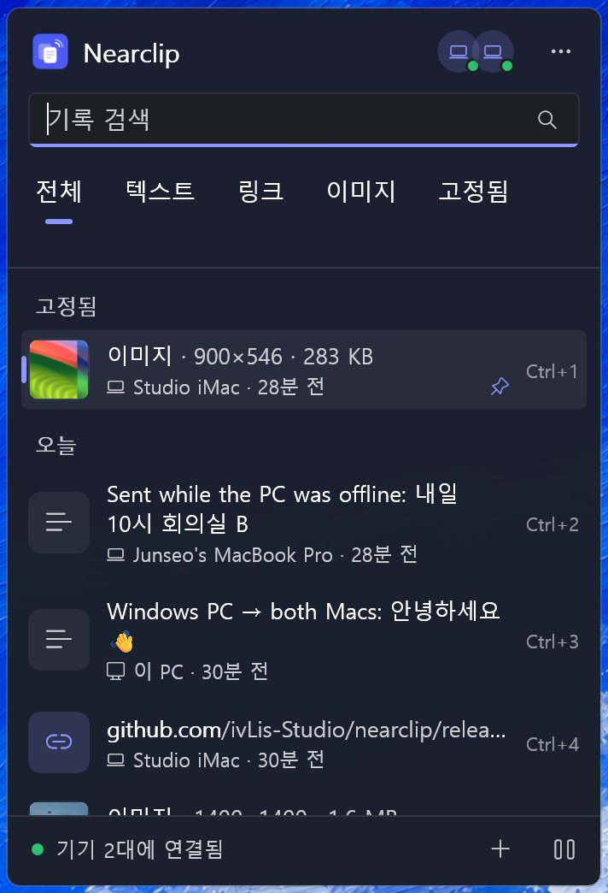<br><sub>Windows · 플라이아웃 (Win+Alt+V)</sub></td>
<td align="center">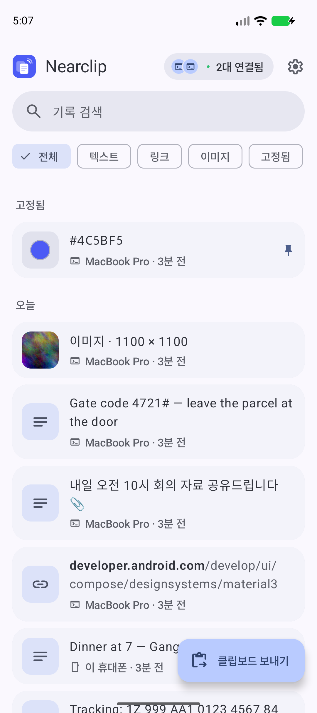<br><sub>Android · 기록</sub></td>
<td align="center">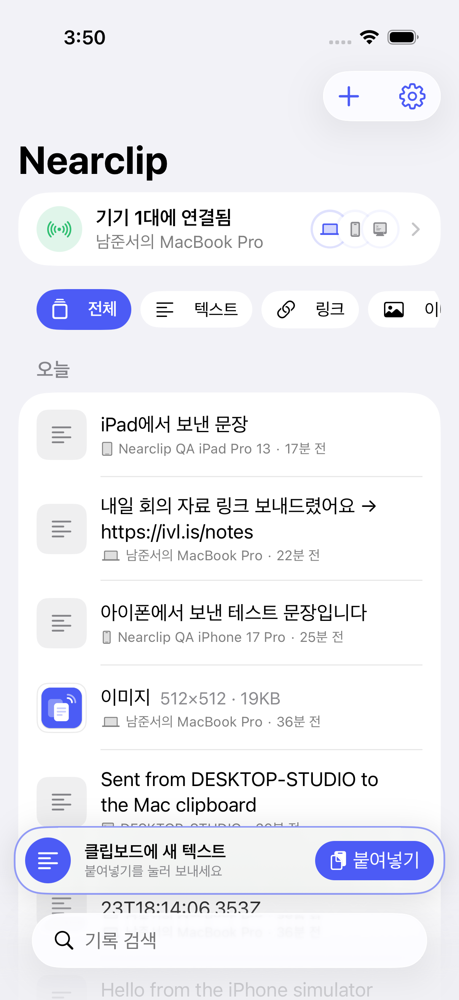<br><sub>iPhone · 기록 + 붙여넣기 막대</sub></td>
</tr>
<tr>
<td align="center">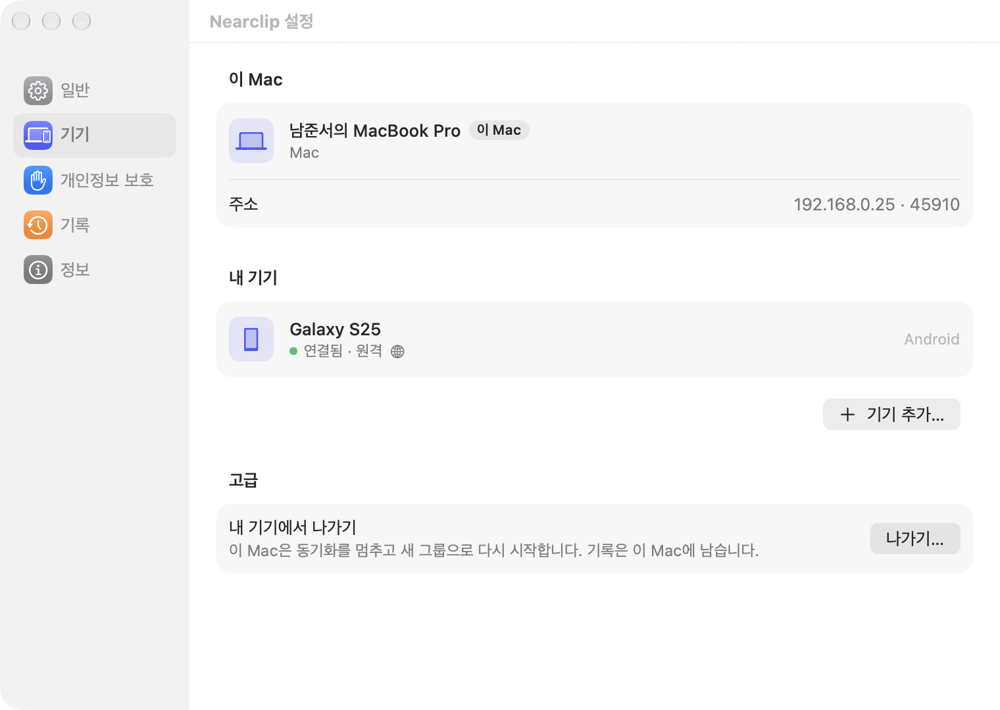<br><sub>macOS · 기기, 다른 네트워크의 휴대폰</sub></td>
<td align="center">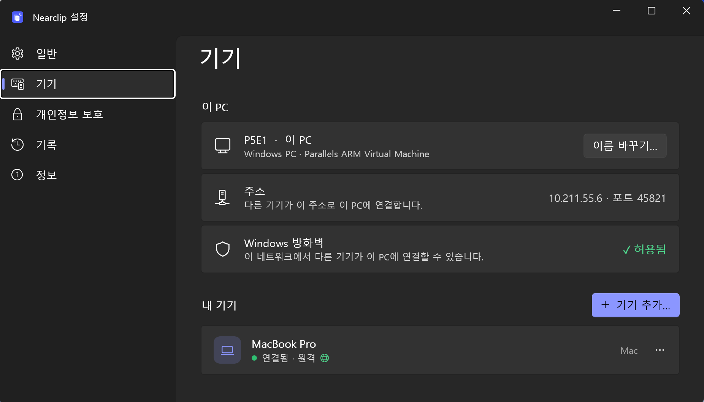<br><sub>Windows · 기기</sub></td>
<td align="center">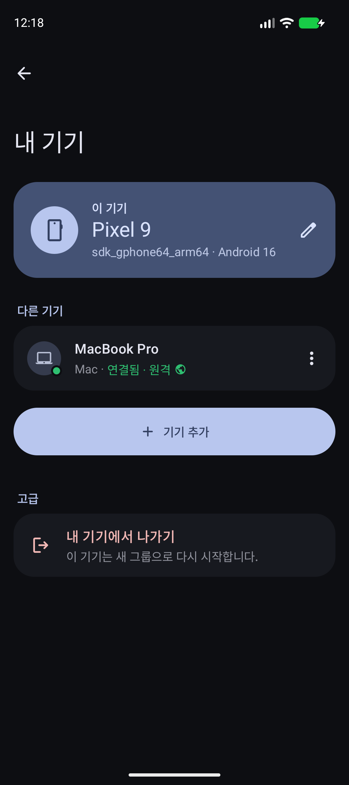<br><sub>Android · 내 기기</sub></td>
<td align="center">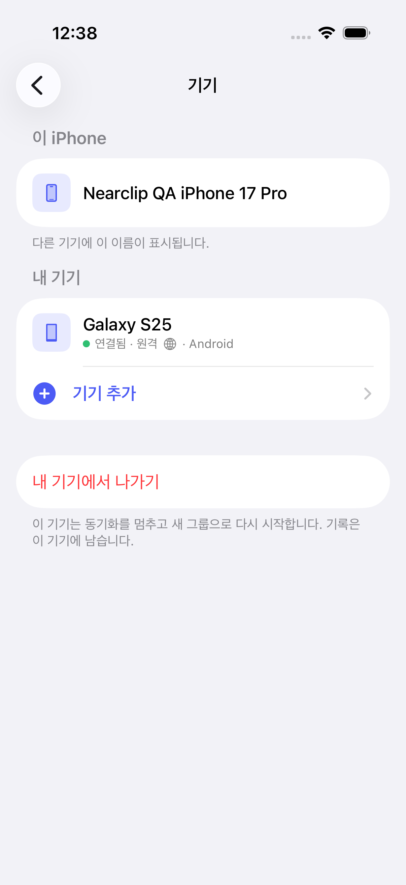<br><sub>iPhone · 기기</sub></td>
</tr>
</table>
<p align="center"><sub>실제 앱 화면(가상 기기 사용, 원격 화면은 테스트용 조정 서버). 모든 화면의 라이트·다크, 한국어·영어 버전: <a href="docs/screenshots">docs/screenshots</a></sub></p>

## 서드파티 소프트웨어

원격 연결에는 오픈 소스 소프트웨어가 들어 있습니다: Tailscale(BSD-3-Clause), wireguard-go(MIT), gVisor(Apache-2.0),
Go 표준 라이브러리(BSD-3-Clause) 및 기타 Go 모듈. 라이선스 전문은
[tailnet/notices/THIRD_PARTY_NOTICES.txt](tailnet/notices/THIRD_PARTY_NOTICES.txt)와 각 앱의 정보 › 오픈 소스 라이선스에
있습니다. Android의 선택 기능인 즉시 불러오기는 Shizuku API(MIT)와 Android Hidden API Bypass(Apache-2.0)를 쓰며,
라이선스 전문은 Android 앱의 설정 › 오픈 소스 라이선스에 있습니다. 웹사이트는 [Lucide](https://lucide.dev) 아이콘(ISC)을 씁니다.

## 라이선스

MIT © 2026 ivLis Studio

