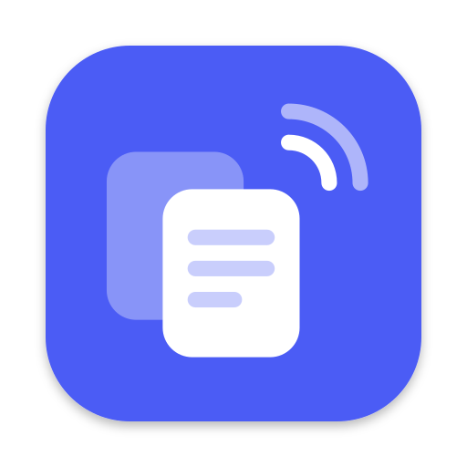

<p align="center"></p>

<h1 align="center">Nearclip</h1>
<p align="center"><b>Copy here. Paste there.</b><br>A universal clipboard for Mac, Windows, Android and iPhone that never leaves your local network.</p>

<p align="center"><a href="README.ko.md">한국어</a></p>

---

Copy on one device, paste on any other. Nearclip keeps the clipboard — and a shared, searchable history — in sync
between your own devices on the same Wi-Fi. There is **no server and no account**: devices find each other with
Bonjour/mDNS and talk directly over TCP, and everything is **end-to-end encrypted** with keys that only your devices hold.

| | macOS | Windows | Android | iOS / iPadOS |
|---|---|---|---|---|
| App | menu bar app + Spotlight-style panel | tray app + Win+V-style flyout | Material 3 app + background service | SwiftUI app |
| Language / UI | Swift · SwiftUI + AppKit | C# · WinUI 3 (Windows App SDK) | Kotlin · Jetpack Compose | Swift · SwiftUI |
| Sending | automatic on copy | automatic on copy | open app, Quick Settings tile, notification, share sheet, text selection | Paste button / automatic on open |
| Receiving | automatic (+ toast) | automatic (+ toast) | automatic in background | while open (+ catch-up on open) |
| Folder | `apple/macOS` | `windows/` | `android/` | `apple/iOS` |

All four are native apps (no Electron, no web views).

## Features

* **Real-time sync** of text, links, colors and images (up to 32 MB).
* **Shared history** on every device: search, filters (Text · Links · Images · Pinned), pin, delete everywhere.
* **Pairing without accounts**: scan a QR code with a phone (or the system camera), or pick a nearby computer and compare
  a 6-digit code on both screens. Any paired device can add more devices.
* **Mesh sync**: every device connects to every reachable device; clips are forwarded, so partially connected networks
  still converge. Devices that were away catch up on the last 7 days when they come back.
* **Private by design**: items marked as private by password managers are never synced (macOS `org.nspasteboard.ConcealedType`,
  Windows `ExcludeClipboardContentFromMonitorProcessing`…, Android `EXTRA_IS_SENSITIVE`), per-app ignore list on computers,
  pause switch, delete-everywhere.
* **Native polish**: Liquid Glass on macOS 26+, Mica on Windows 11, Material You on Android, SwiftUI on iOS; light/dark;
  English and Korean; keyboard-first desktop panels (⌃⌘V on Mac, Win+Alt+V on Windows).

## How it works

```
 Mac ──────────── Windows PC         • discovery: DNS-SD service _nearclip._tcp (Bonjour / mDNS)
  │  ╲          ╱    │               • transport: one TCP connection per pair of devices, length-prefixed frames
  │    ╲      ╱      │               • crypto: P-256 ECDH (ephemeral) + HKDF-SHA256 + AES-256-GCM
 iPhone ──── Android                  • a clip received from one peer is forwarded to the others (dedup by id)
```

* Every installation creates a **group** (random 256-bit key). Pairing hands that key to the new device over a channel
  authenticated by the QR secret or by the 6-digit numeric comparison (with a commitment, so a man in the middle
  cannot force matching numbers).
* Each connection runs an ephemeral ECDH handshake bound to the group key (forward secrecy); all clip data, member lists
  and pairing results are encrypted. The wire protocol is specified in [docs/PROTOCOL.md](docs/PROTOCOL.md) and pinned
  by [spec/test-vectors.json](spec/test-vectors.json).
* Product and UX decisions are in [docs/DESIGN.md](docs/DESIGN.md).

## Build & run

### macOS and iOS (`apple/`)

Requirements: Xcode 16 or newer (built and tested with Xcode 27 beta), [XcodeGen](https://github.com/yonaskolb/XcodeGen).

```sh
cd apple
xcodegen generate                 # creates Nearclip.xcodeproj (also committed)
open Nearclip.xcodeproj           # schemes: Nearclip (macOS), NearclipiOS
scripts/build-release.sh          # universal, ad-hoc signed dist/Nearclip-macOS.zip
```

* macOS 14+. The app lives in the menu bar (and behind ⌃⌘V). On first copy macOS asks whether Nearclip may read
  the clipboard — choose **Always Allow** (System Settings › Privacy & Security › Paste from Other Apps).
* iOS 17+. To run on an iPhone, select your team in *Signing & Capabilities* of the `NearclipiOS` target.

### Android (`android/`) and Windows (`windows/`)

See [android/README.md](android/README.md) and [windows/README.md](windows/README.md).

## Tests

| Suite | Command |
|---|---|
| Swift engine (vectors + localhost pairing/sync scenarios) | `cd apple/NearclipKit && swift test` |
| Kotlin engine | `cd android && ./gradlew :core:test` |
| C# engine | `cd windows && dotnet test --project tests/Nearclip.Core.Tests/Nearclip.Core.Tests.csproj` |
| **Cross-implementation interop** (Swift × Kotlin × C#, 24 scenarios) | `python3 tools/interop/run.py` |
| iOS UI flow (onboarding → pair → catch-up → send) | `xcodebuild test -scheme NearclipiOS …` (see `apple/iOSUITests`) |
| macOS acceptance demo (real app + simulated peers) | `python3 apple/tools/demo.py` |

## Limitations

* All devices must be on the **same local network** (no internet relay by design). Guest or corporate Wi-Fi that blocks
  device-to-device traffic or mDNS needs *Connect by address*.
* iOS only syncs while Nearclip is open (iOS does not allow background clipboard access); it catches up instantly when
  opened and can copy the newest clip automatically.
* Android 10+ only lets the foreground app read the clipboard: sending uses the app, the Quick Settings tile, the
  notification action, the share sheet or the text-selection menu. Receiving works in the background.
* Removing a device is cooperative; for a full key rotation, leave and pair the remaining devices again.

## License

MIT © 2026 ivLis Studio

