<p align="center">
  <a href="https://ivlis-studio.github.io/nearclip/">
    <picture>
      <source media="(prefers-color-scheme: dark)" srcset="docs/readme/banner-en-dark.png">
      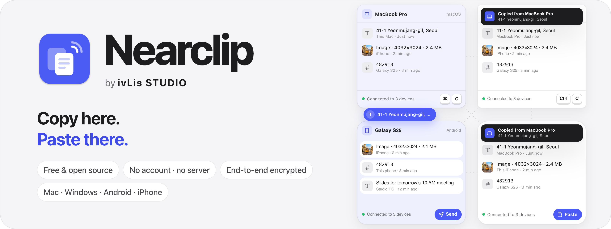
    </picture>
  </a>
</p>

<p align="center">
  <a href="https://github.com/ivLis-Studio/nearclip/releases/latest"></a>
  <a href="https://github.com/ivLis-Studio/nearclip/releases"></a>
  
  
  
  
  <a href="LICENSE"></a>
</p>

<p align="center"><b>Free for Mac, Windows, Android and iPhone</b> — no account, no server, end-to-end encrypted.</p>

<p align="center">
  <a href="https://github.com/ivLis-Studio/nearclip/releases/latest"><b>Download</b></a> ·
  <a href="https://apps.microsoft.com/detail/9PNQ3Z9S83QS"><b>Microsoft Store</b></a> ·
  <a href="https://ivlis-studio.github.io/nearclip/"><b>Website</b></a> ·
  <a href="#install">Install</a> ·
  <a href="#how-it-works">How it works</a> ·
  <a href="docs/PROTOCOL.md">Protocol</a> ·
  <a href="README.ko.md">한국어</a>
</p>

<!-- The film is a GitHub attachment, so it plays inline here. Source: promo/ -->
https://github.com/user-attachments/assets/481e0b9a-8704-4dc0-aacd-5fb4c61d13f6

<p align="center"><sub>39 seconds · turn the sound on · <a href="https://ivlis-studio.github.io/nearclip/#film">Watch on the website</a></sub></p>

## Copy on one. Paste on any other.

Nearclip keeps one clipboard — and one searchable history — across your Mac, Windows PC, Android phone, iPhone and iPad.
Mac and iPhone already share a clipboard, and so do some Windows PCs and Android phones. Nearclip connects **every
device with every device**, whoever made it.

On your Wi-Fi the devices find each other and talk directly. Turn on **Remote connection** and they reach each other
across networks too, through a Tailscale node built into every app. There is **no Nearclip server and no account**, and
everything is **end-to-end encrypted** with keys only your devices hold.

<table>
  <tr>
    <td width="33%" valign="top">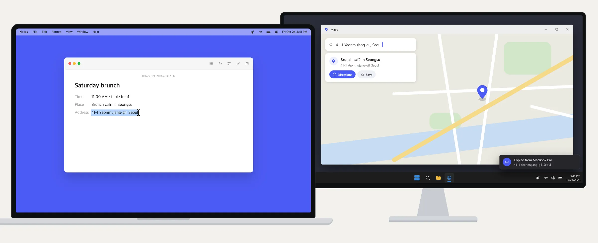<br><b>Mac → Windows PC</b><br><sub>The address in your notes, straight into the map on your PC.</sub></td>
    <td width="33%" valign="top">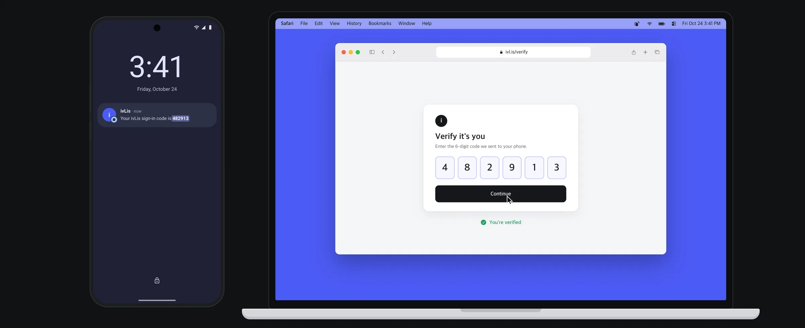<br><b>Android → Mac</b><br><sub>The sign-in code on your Galaxy — ⌘V and you're in.</sub></td>
    <td width="33%" valign="top">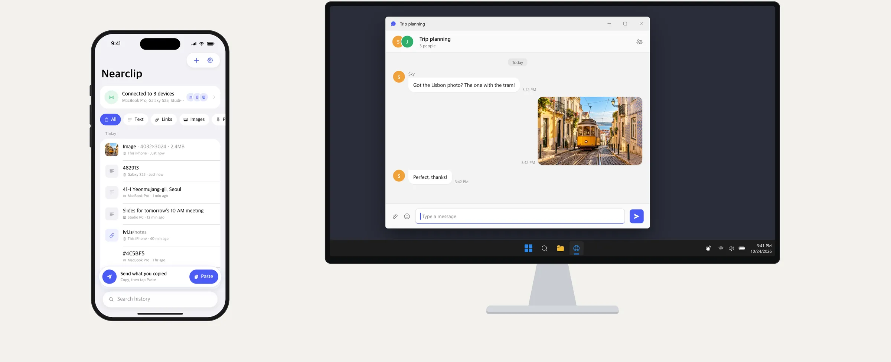<br><b>iPhone → Windows PC</b><br><sub>The photo you just took, Ctrl+V into a chat on your PC.</sub></td>
  </tr>
</table>

## Four native apps

<table>
  <tr>
    <td align="center" valign="top" width="25%">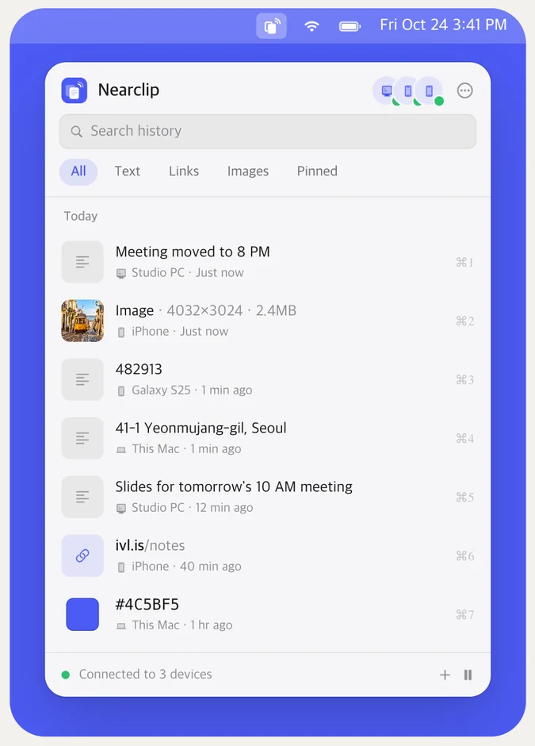<br><b>macOS</b><br><sub>Menu bar app · <kbd>⌃⌘V</kbd> opens the history panel</sub></td>
    <td align="center" valign="top" width="25%">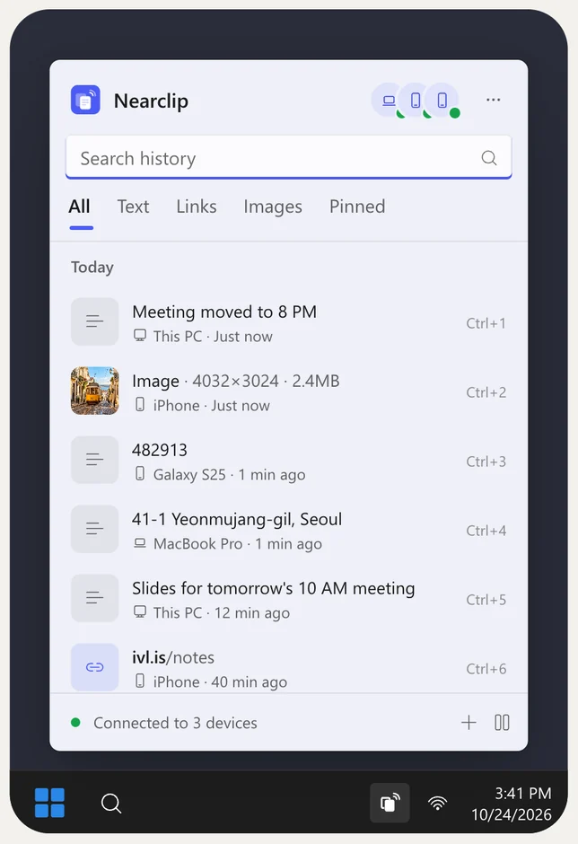<br><b>Windows</b><br><sub>Tray app · <kbd>Win</kbd> <kbd>Alt</kbd> <kbd>V</kbd> opens the flyout</sub></td>
    <td align="center" valign="top" width="25%">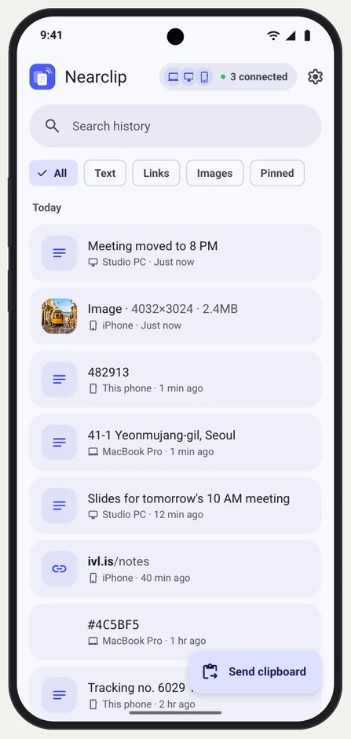<br><b>Android</b><br><sub>Receives in the background · send from a tile, Share or the text menu</sub></td>
    <td align="center" valign="top" width="25%">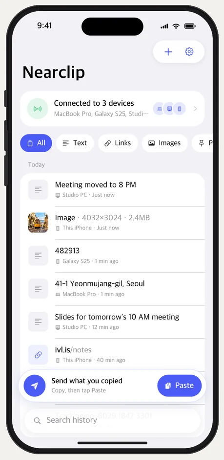<br><b>iPhone &amp; iPad</b><br><sub>Tap Paste to send · catches up the moment it opens</sub></td>
  </tr>
</table>
<p align="center"><sub>The same history in all four apps, as drawn in the launch film. Real screenshots are <a href="#screenshots">below</a> and in <a href="docs/screenshots">docs/screenshots</a>.</sub></p>

| | macOS | Windows | Android | iOS / iPadOS |
|---|---|---|---|---|
| Built with | Swift · SwiftUI + AppKit | C# · WinUI 3 (Windows App SDK) | Kotlin · Jetpack Compose | Swift · SwiftUI |
| Sending | automatic on copy | automatic on copy | the app, Quick Settings tile, notification, Share, text selection — or instantly with Shizuku | Paste button, or automatically on open |
| Receiving | automatic, with a toast | automatic, with a toast | automatic, in the background | while open, plus catch-up on open |
| Requires | macOS 14 | Windows 10 1809 | Android 8 | iOS 17 |
| Source | [apple/macOS](apple/macOS) | [windows/](windows) | [android/](android) | [apple/iOS](apple/iOS) |

No Electron, no web views: each app uses its platform's own controls, fonts and icons.

## Features

- **Real-time sync** of text (up to 4 MB), links, colors and images (up to 32 MB, PNG or JPEG).
- **Big images show up right away.** The copying device announces an image before it encodes it, so the others show
  *Receiving an image from iPhone…* with the size and a progress bar at once — in the toast on computers, as a card in
  the phone apps, as a quiet banner on Android in the background — and the same place turns into *Copied from iPhone*.
- **One shared history** on every device: search, filters (Text · Links · Images · Pinned), pin, delete everywhere.
- **Pairing without accounts.** Scan a QR code with a phone, or pick a nearby computer and compare a 6-digit code on
  both screens. Any paired device can add more.
- **Mesh sync.** Every device connects to every device it can reach and passes clips on, so partly connected networks
  still converge. A device that was away catches up on the last 7 days when it comes back.
- **Remote connection** (optional). Turn on *Sync across networks* and sign in with the same free Tailscale account on
  each device. Every app embeds its own Tailscale node — nothing else to install, no VPN profile. Wi-Fi stays preferred,
  and each device shows how it's connected: *Connected · Same network* or *Connected · Remote*.
- **Private by design.** Items that password managers mark private are never synced (macOS
  `org.nspasteboard.ConcealedType`, Windows `ExcludeClipboardContentFromMonitorProcessing`, Android
  `EXTRA_IS_SENSITIVE`), computers can ignore apps, and every device can pause.
- **Feels at home.** Liquid Glass on macOS 26, Mica on Windows 11, Material You on Android; light and dark; English and
  Korean; keyboard-first desktop panels.

## Install

### Mac

1. Download **Nearclip-macOS.zip** from [Releases](https://github.com/ivLis-Studio/nearclip/releases/latest), unzip it
   and move Nearclip to Applications.
2. Open it. Nearclip is signed and notarized by Apple, so it opens like any other app. It lives in the menu bar, and
   <kbd>⌃⌘V</kbd> opens your history.
3. The first time Nearclip reads the clipboard, macOS asks: choose **Always Allow** (System Settings › Privacy & Security
   › Paste from Other Apps). Allow **Local Network** when asked, too.

Requires macOS 14 or later, Apple silicon or Intel.

### Windows

Get it from the [**Microsoft Store**](https://apps.microsoft.com/detail/9PNQ3Z9S83QS). The Store version is signed by
Microsoft and updates itself.

Or download it directly from GitHub:

1. Download **Nearclip-Windows-x64.zip** (**Nearclip-Windows-arm64.zip** for Snapdragon PCs) from
   [Releases](https://github.com/ivLis-Studio/nearclip/releases/latest), unzip it anywhere and run `Nearclip\Nearclip.exe`.
2. The ZIP isn't code-signed yet, so SmartScreen may say **"Windows protected your PC"**: click **More info › Run anyway**.
3. When the firewall asks, allow Nearclip on **private networks**. Onboarding and Settings show the firewall status and
   an *Allow…* button.

Requires Windows 10 version 1809 or later, or Windows 11 (x64 or Arm64). The ZIP's folder is self-contained — no installer
and no .NET to install. Nearclip lives in the notification area; <kbd>Win</kbd> <kbd>Alt</kbd> <kbd>V</kbd> opens your history.

### Android

1. On your phone, download **Nearclip-Android.apk** from [Releases](https://github.com/ivLis-Studio/nearclip/releases/latest)
   and open it. Allow your browser to install unknown apps when asked.
2. Allow notifications: they keep the connection alive in the background and show what arrived.
3. Optional: Settings › **Bring copies into Nearclip instantly** sends text and links the moment you copy them, with
   [Shizuku](https://shizuku.rikka.app). The setup sheet walks you through it; nothing changes until you turn it on.

Requires Android 8 or later.

### iPhone and iPad

Nearclip isn't on the App Store yet. Building it takes a few minutes:

1. Install Xcode and [XcodeGen](https://github.com/yonaskolb/XcodeGen) (`brew install xcodegen`), then build the
   embedded Tailscale library: `tailnet/build.sh apple` (Go; see [tailnet/README.md](tailnet/README.md)).
2. `cd apple && xcodegen generate && open Nearclip.xcodeproj`
3. Pick the **NearclipiOS** scheme, choose your Apple ID as the team under *Signing & Capabilities*, and run it on your
   iPhone or iPad. Apps installed with a free Apple ID have to be reinstalled every 7 days.

Requires iOS 17 or later.

### Add your devices

Open **Add device** on a device that's already set up:

- **A phone**: scan the QR code with the Nearclip app (the camera app works too).
- **A computer**: pick it under *Nearby* and check that both screens show the same 6-digit code.
- **Guest or office Wi-Fi** that blocks discovery between devices: use *Connect by address*.
- **Different networks**: turn on **Remote connection** on each device and sign in with the same free Tailscale account.

## How it works

```
 Mac ──────────── Windows PC         • discovery: DNS-SD service _nearclip._tcp (Bonjour / mDNS)
  │  ╲          ╱    │               • transport: one TCP connection per pair of devices, length-prefixed frames
  │    ╲      ╱      │               • crypto: P-256 ECDH (ephemeral) + HKDF-SHA256 + AES-256-GCM
 iPhone ──── Android                  • a clip received from one peer is forwarded to the others (dedup by id)
```

- Every installation creates a **group** with a random 256-bit key. Pairing hands that key to the new device over a
  channel authenticated by the QR secret or by the 6-digit numeric comparison (with a commitment, so a man in the middle
  cannot force matching numbers).
- Each connection runs an ephemeral ECDH handshake bound to the group key (forward secrecy); all clip data, member lists
  and pairing results are encrypted. The wire protocol is specified in [docs/PROTOCOL.md](docs/PROTOCOL.md) and pinned
  by [spec/test-vectors.json](spec/test-vectors.json), which the Swift, Kotlin and C# engines all pass.
- **Remote connection** ([PROTOCOL.md §10](docs/PROTOCOL.md), [tailnet/](tailnet/README.md)): each app runs a
  [tsnet](https://tailscale.com/kb/1244/tsnet) node in userspace (WireGuard and gVisor's network stack; no system VPN)
  named `nearclip-<device>-<id>`. Devices of a group find each other among the tailnet's machines by that name and
  connect through the node — directly when NAT traversal works, through Tailscale's relays (DERP) otherwise. The
  Nearclip session and its encryption run unchanged inside WireGuard: Tailscale's coordination server sees device
  names and addresses, never clips.
- Product and UX decisions — vocabulary, flows, every platform's surfaces — are in [docs/DESIGN.md](docs/DESIGN.md).

## Privacy

Nearclip has no server, no account, no analytics and no telemetry. History stays on your devices for as long as you
choose (30 days by default); deleting a clip deletes it everywhere. The full policy, in English and Korean, is on the
[website](https://ivlis-studio.github.io/nearclip/privacy.html).

## Build from source

| Folder | What's inside |
|---|---|
| [apple/](apple) | macOS and iOS apps (XcodeGen project) and **NearclipKit**, the Swift engine with its CLI |
| [windows/](windows/README.md) | the WinUI 3 app and the C# engine |
| [android/](android/README.md) | the Android app, the Kotlin engine (`:core`) and the interop CLI |
| [tailnet/](tailnet/README.md) | the embedded Tailscale library (Go) shared by all four apps |
| [docs/](docs), [spec/](spec) | protocol, design and the cross-platform test vectors |
| [tools/](tools) | the interop runner and the acceptance scripts |
| [design/](design) | app icons for every platform |
| [promo/](promo/README.md) | the launch film, rendered from code |
| [website/](website/README.md) | [ivlis-studio.github.io/nearclip](https://ivlis-studio.github.io/nearclip/) |

**First, the embedded Tailscale library.** Remote connection needs a small Go library per platform, built outside Xcode,
Gradle and .NET (they stop with a clear message when it's missing):

```sh
tailnet/build.sh all              # Go (tailnet/go.mod), Xcode, the Android NDK and llvm-mingw — see tailnet/README.md
```

It writes `apple/NearclipKit/Binaries/NCTailnet.xcframework`, `android/app/src/main/jniLibs/*/libnctailnet.so` and
`windows/native/win-*/nctailnet.dll` (all gitignored) and refreshes `tailnet/notices/THIRD_PARTY_NOTICES.txt`.

**macOS and iOS** — Xcode 16 or newer (built and tested with Xcode 27), XcodeGen:

```sh
cd apple
xcodegen generate                 # Nearclip.xcodeproj (also committed); schemes Nearclip (macOS) and NearclipiOS
scripts/build-release.sh          # universal dist/Nearclip-macOS.zip, signed ad hoc
SIGN_IDENTITY="Developer ID Application: …" NOTARY_PROFILE=<notarytool profile> scripts/build-release.sh   # notarized
```

The **App Store** builds come from the same project: `NearclipiOS` (iPhone and iPad) and `NearclipAppStore`, the Mac app
sandboxed (`apple/AppStore/Nearclip.entitlements`: network client and server, user-selected files). The sandboxed build
compiles with `APPSTORE`, which leaves out "Paste after choosing" (sending ⌘V to another app); it keeps its data in its
container, so it does not share pairing with the Developer ID build. Archive with a released Xcode and upload with
`xcodebuild -exportArchive` (method `app-store-connect`, destination `upload`). Listing copy is in
`docs/store/app-store.json`; the screenshots come from `apple/tools/appstore_shots.py` (iPhone and iPad simulators),
`apple/tools/appstore_mac_shots.py` (the Mac app) and `promo/appstore.sh`, which frames them.

**Android** — see [android/README.md](android/README.md); `android/scripts/build-release.sh` builds the R8 release and
signs it with the release key. **Windows** — see [windows/README.md](windows/README.md) (`dotnet publish`, .NET 10 SDK
only, no Visual Studio needed).

## Tests

| Suite | Command |
|---|---|
| Swift engine (vectors + localhost pairing/sync scenarios) | `cd apple/NearclipKit && swift test` |
| Kotlin engine | `cd android && ./gradlew :core:test` |
| C# engine | `cd windows && dotnet test --project tests/Nearclip.Core.Tests/Nearclip.Core.Tests.csproj` |
| Tailnet bridge (Go, against an in-process control server) | `cd tailnet && go test ./...` |
| **Cross-implementation interop** (Swift × Kotlin × C#, 48 scenarios incl. remote and image progress) | `python3 tools/interop/run.py` |
| iOS UI flow (onboarding → pair → catch-up → send; remote; licenses) | `xcodebuild test -scheme NearclipiOS …` (see `apple/iOSUITests`) |
| macOS acceptance demo (real app + simulated peers) | `python3 apple/tools/demo.py` |
| Large-image progress in the real apps (a peer that sends slowly; screenshots) | `tools/acceptance/mac_transfer.py`, `windows_transfer.py`, `android_transfer.py`, `apple/tools/ios_transfer.py` |
| Remote connection in the real apps (throwaway Tailscale control server) | `apple/tools/remote_demo.py`, `apple/tools/ios_remote.py`, `tools/acceptance/android_remote.py`, `windows_remote.py` |
| Remote connection against the real Tailscale service (a person signs in) | `python3 tools/acceptance/real_remote.py` |
| Website (both languages, the live demo, film, phone layout) | `cd website && npm install && npm test` |

<details>
<summary><b>What has been verified</b></summary>

- **Engines**: Swift 12 tests, Kotlin 24 tests, C# 33 tests, Go bridge tests — every value in `spec/test-vectors.json`
  plus real localhost pairing/sync scenarios and the tailnet dialing/discovery logic.
- **Interop**: `tools/interop/run.py` passes **48/48** scenarios across Swift × Kotlin × C# (QR and code pairing in every
  direction, live text in Korean + emoji, multi-chunk images, delete everywhere, catch-up after restart, removal,
  re-adding a removed device, 3-hop mesh forwarding in every permutation, image progress for every ordered pair, and
  remote: every ordered pair pairs on the LAN, comes back with remote connection on, finds the other through the
  tailnet and syncs both ways).
- **Large-image progress in the real apps** (a peer sending a 10.6 MB photo at 0.9 MB/s): the macOS app, the Windows 11
  ARM64 VM, the Android 16 emulator and the iPhone simulator showed *Receiving an image from …* with *Preparing…*, then
  the size counting up, and turned into *Copied from …* in place with the image on the clipboard. Cancelled
  announcements, a sender dropping mid-transfer and auto-copy off behave as designed.
- **The shipped builds**: the macOS zip run as an isolated instance (Developer ID signature, notarization ticket,
  universal binary, pairing, text both ways); the Android release APK; the Windows arm64 and x64 builds (pairing through
  a link, text both ways through the Windows clipboard). Then the four apps in one group (macOS build, Windows VM, Android
  emulator, iPhone simulator): each sent a text and the other three got it, each with its one true source.
- **Real apps, one group** (macOS app, iPhone/iPad simulators, Android 16 emulator, Windows 11 ARM64 VM): a clip copied
  on each platform arrived on all the others. Discovery over Bonjour/mDNS between Macs, Mac ↔ iOS, Mac ↔ Windows and
  Android → Mac; code pairing with matching 6-digit codes; password-manager items skipped.
- **Remote connection** against a throwaway Tailscale control server (the real tsnet, WireGuard and DERP code): all four
  apps listed a peer that was not reachable over the LAN as *Connected · Remote* and received its clip. **Against the
  real Tailscale service**: the macOS app and the Android app signed in, listed each other as *Connected · Remote* after
  the LAN path was taken away, and synced both ways over a direct WireGuard path.
- **Not verified yet**: real phones and a real Windows PC in this pass; two genuinely different networks (NAT traversal
  across the internet and the DERP fallback); iPhone and Windows against the real Tailscale service; battery use.

</details>

## Limitations

- Without Remote connection, devices must be on the **same local network**; guest or office Wi-Fi that blocks
  device-to-device traffic or mDNS needs *Connect by address*. Remote connection needs a free Tailscale account signed in
  on each device; without a direct path, traffic goes through Tailscale's relays — still end-to-end encrypted, but
  slower. Tailnets with custom access rules must allow TCP 45821 between your devices.
- iOS only syncs while Nearclip is open (iOS doesn't allow background clipboard access); it catches up instantly when
  opened and can copy the newest clip automatically. The same goes for its remote connection.
- Android 10+ only lets the foreground app read the clipboard: sending uses the app, the tile, the notification, Share
  or the text-selection menu, unless you turn on instant capture with Shizuku (restart Shizuku after a reboot on
  non-rooted phones; Android 12+ may show a clipboard-access notice per copy). Receiving works in the background.
- Removing a device is cooperative; for a full key rotation, leave and pair the remaining devices again.
- The Windows ZIP on GitHub isn't code-signed yet (SmartScreen warns on downloaded copies) and is a self-contained folder
  rather than an installer; the Microsoft Store version is signed and installs like any Store app. The Android APK is
  signed with Nearclip's release key — if you installed an earlier test build, uninstall it first.

## Screenshots

<table>
<tr>
<td align="center">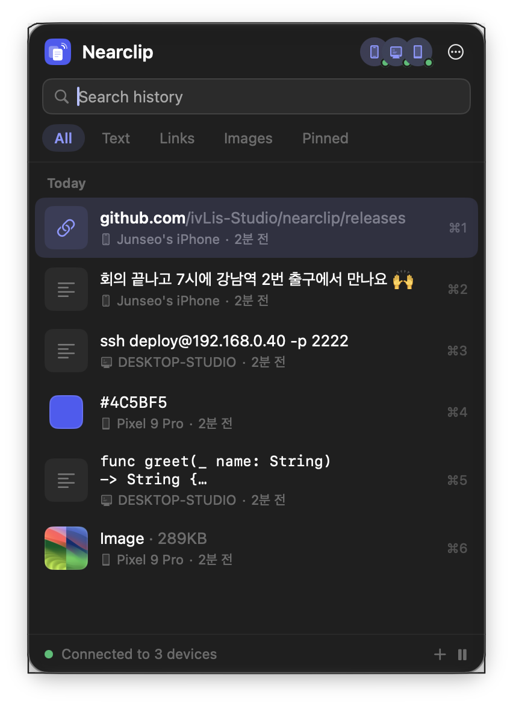<br><sub>macOS · menu bar panel (⌃⌘V)</sub></td>
<td align="center">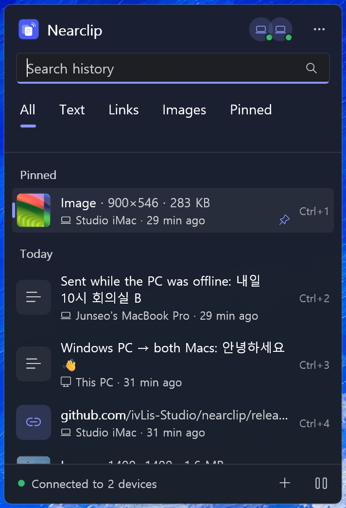<br><sub>Windows · tray flyout (Win+Alt+V)</sub></td>
<td align="center">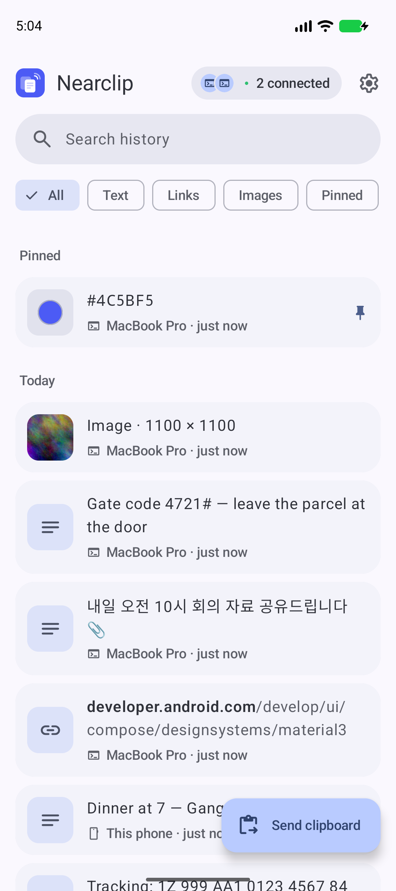<br><sub>Android · history</sub></td>
<td align="center">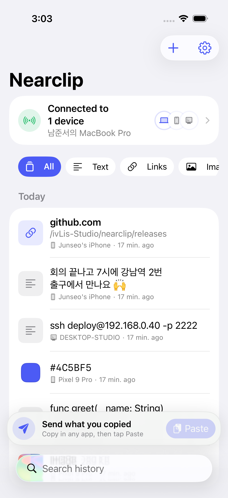<br><sub>iPhone · history + Paste bar</sub></td>
</tr>
<tr>
<td align="center"><br><sub>macOS · Devices, a phone on another network</sub></td>
<td align="center"><br><sub>Windows · Devices</sub></td>
<td align="center"><br><sub>Android · My devices</sub></td>
<td align="center"><br><sub>iPhone · Devices</sub></td>
</tr>
</table>
<p align="center"><sub>Real captures from the apps (simulated peers; the remote ones with a test control server). Every screen, in light and dark, English and Korean: <a href="docs/screenshots">docs/screenshots</a>.</sub></p>

## Third-party software

Remote connection embeds open-source software: Tailscale (BSD-3-Clause), wireguard-go (MIT), gVisor (Apache-2.0), the Go
standard library (BSD-3-Clause) and other Go modules. Their license texts are in
[tailnet/notices/THIRD_PARTY_NOTICES.txt](tailnet/notices/THIRD_PARTY_NOTICES.txt) and in each app under About ›
Open-source licenses. Optional Android instant capture uses the Shizuku API (MIT) and Android Hidden API Bypass
(Apache-2.0); their license texts are in the Android app under Settings › Open-source licenses. The website uses
[Lucide](https://lucide.dev) icons (ISC).

## License

MIT © 2026 ivLis Studio

